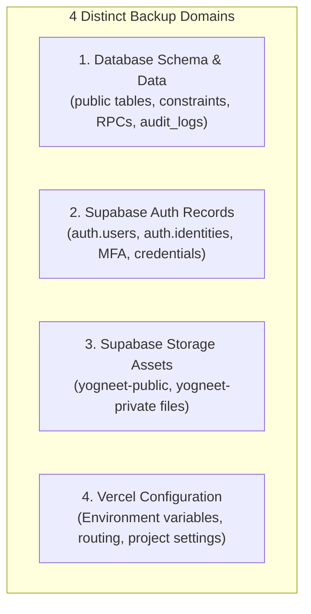

# YOGNEET EDU — PRODUCTION BACKUP AND DISASTER RECOVERY PLAN

**Date:** November 3, 2026  
**Auditor:** Senior DevOps & Reliability Engineer  
**Production Project Ref:** `acmhdklihpqzurzuthkw` (`https://acmhdklihpqzurzuthkw.supabase.co`)  
**Production Region:** `ap-northeast-1` (Tokyo, Japan)  
**Database Engine:** PostgreSQL 17 (`17.11.0.003`)  
**Organization:** `rqjmpcqdpangzexxorkv` (`datascientistadarsh@gmail.com's Org`)  

---

## 1. PURPOSE AND REALISTIC CAPABILITY ASSESSMENT

This disaster recovery and backup operational standard outlines the concrete, verified procedures to protect and restore the Yogneet Edu production database, authentication records, storage assets, and configurations.

> [!CAUTION]
> **STRICT SAFETY RULE: ZERO DESTRUCTIVE RESTORES ON STAGING**  
> Under no circumstance should destructive restore commands (`pg_restore --clean`, `supabase db reset`) ever be executed against the active staging environment (`ksjeravfkjfbpvfdazus`). All disaster recovery drills must utilize an isolated, temporary, disposable Supabase project or container.

### **Important Distinction: Configured Capabilities vs. Documented Procedures**

| Capability / Tier Feature | Current Production Status | Recovery Metric Attainability | Operational Notes |
| :--- | :--- | :--- | :--- |
| **Standard Automated Backups** | **Active on Supabase Pro / Daily** | **RPO: ≤ 24 Hours**<br>**RTO: Unverified (Est. 30–60 Min)** | Daily physical snapshots maintained by Supabase managed infrastructure. Under a major outage immediately prior to the daily snapshot, data loss window spans up to 24 hours. **RTO < 30 minutes CANNOT be claimed without empirical measured drill evidence.** |
| **Point-In-Time Recovery (PITR)** | **UNVERIFIED / DISABLED by default** | **RPO: < 5 Minutes (If Enabled)**<br>**RTO: Unverified (Est. 30–60 Min)** | Continuous Write-Ahead Log (WAL) archiving is **NOT enabled by default**. It requires explicit purchase and activation of the PITR add-on ($100/mo) in the Supabase Dashboard. **Do not claim PITR is active unless verified in the production dashboard.** |
| **Logical Schema / Data Dumps** | **Executable On-Demand via CLI** | **RPO: Point of manual dump**<br>**RTO: Subject to restore duration** | Performed before migrations and major releases via `pg_dump`. Protects schema and application state at the release boundary. |

> [!IMPORTANT]
> - **RTO Caveat:** Industry standard recovery time objectives must be validated through measured drills. Claiming RTO < 30 minutes without timed execution benchmarks is premature.
> - **PITR Status:** Continuous WAL streaming must be treated as **UNVERIFIED / DISABLED** until the project administrator verifies its active status in **Supabase Dashboard** → **Project Settings** → **Database** → **Point in time recovery**.

---

## 2. FOUR DISTINCT BACKUP DOMAINS

A comprehensive disaster recovery posture requires backing up four distinct platform subsystems:



### Domain 1: Database Schema & Application Data
- **Scope:** All 18 public tables (`profiles`, `assessments`, `assessment_questions`, `assessment_attempts`, `audit_logs`, `study_notes`, `video_lessons`, `micro_lessons`, `icon_library`, `student_feedback`, etc.), plus views, sequences, triggers, and functions.
- **Backup Mechanism:** Logical dump using `pg_dump` with custom compressed archive format (`-F c`).
- **Command:**
  ```bash
  pg_dump -h db.acmhdklihpqzurzuthkw.supabase.co -U postgres -d postgres -n public -F c -b -v -f "yogneet_db_public_$(date +%Y%m%d_%H%M%S).dump"
  ```

### Domain 2: Supabase Auth Records
- **Scope:** User identity table `auth.users`, confirmed password hashes, email confirmation timestamps, OAuth identities in `auth.identities`, and MFA factors.
- **Critical Distinction:** Auth records reside in the protected `auth` schema and are NOT included in standard public schema dumps.
- **Backup Mechanism:** Schema dump targeting `auth` schema or programmatic user export via Supabase Admin API.
- **Command:**
  ```bash
  pg_dump -h db.acmhdklihpqzurzuthkw.supabase.co -U postgres -d postgres -n auth -F c -b -v -f "yogneet_auth_$(date +%Y%m%d_%H%M%S).dump"
  ```

### Domain 3: Supabase Storage Assets
- **Scope:** Binary objects, avatars, study note PDFs, and custom SVG icons across canonical storage buckets:
  - `yogneet-public`: Public assets (student avatars, staff study notes, custom icons).
  - `yogneet-private`: Gated examination materials and restricted curriculum PDFs.
- **Backup Mechanism:** S3-compatible synchronization using AWS CLI with Supabase S3 storage credentials.
- **Command:**
  ```bash
  aws s3 sync s3://yogneet-public ./storage_backup/yogneet-public --endpoint-url https://acmhdklihpqzurzuthkw.supabase.co/storage/v1/s3
  aws s3 sync s3://yogneet-private ./storage_backup/yogneet-private --endpoint-url https://acmhdklihpqzurzuthkw.supabase.co/storage/v1/s3
  ```

### Domain 4: Vercel Configuration & Environment Backups
- **Scope:** Production environment variables, deployment routing, custom domain mappings, and build configurations.
- **Backup Mechanism:** Vercel CLI environment pull and JSON configuration export.
- **Command:**
  ```bash
  # Export production environment variables to secure encrypted vault
  npx vercel env pull .env.production.backup --environment=production
  ```

---

## 3. VERIFIED STORAGE BUCKET ARCHITECTURE

Audit of the database migrations (`20261026000002_rls_policies.sql`, `20261027000004_remediate_assessment_permissions.sql`), backend services, and live staging confirms:

- **Canonical Public Bucket:** `yogneet-public` (Public: `true`)
  - **Avatars:** Uploaded to `{userId}/avatar-{timestamp}.{ext}` with strict folder-level owner write isolation (`storage.foldername(name)[1] = auth.uid()::text`).
  - **Study Notes:** Uploaded to `notes/{timestamp}_{name}.pdf` (staff write policy).
  - **Custom SVG Icons:** Uploaded to `icons/{timestamp}_{name}.svg` (staff write policy).
- **Canonical Private Bucket:** `yogneet-private` (Public: `false`)
  - Gated study notes and examination papers requiring verified enrollment.
- **Clarification:** There is **NO `yogneet-avatars` bucket** in the schema. References in preliminary documentation were typographic discrepancies. All public uploads utilize `yogneet-public` with folder isolation.

---

## 4. RESTORE DRILL RUNBOOK (DISPOSABLE ENVIRONMENT)

To validate recovery readiness without impacting active environments, follow this non-destructive drill design:

### Step 1: Provision a Separate Disposable Supabase Project
- Provision a brand-new, temporary Supabase project (e.g. `yogneet-drill-disposable` with ref `drill-<random>`) or spin up a local disposable Supabase instance via `supabase start`.
- **NEVER target staging (`ksjeravfkjfbpvfdazus`) or production (`acmhdklihpqzurzuthkw`).**

### Step 2: Restore Database Schema & Data to Disposable Target
```bash
# Target: Separate disposable project ONLY
DISPOSABLE_HOST="db.drill-disposable.supabase.co"

# 1. Restore public schema and domain data
pg_restore -h $DISPOSABLE_HOST -U postgres -d postgres --clean --if-exists -v "yogneet_db_public_drill.dump"

# 2. Restore auth schema records (if performing full identity restore drill)
pg_restore -h $DISPOSABLE_HOST -U postgres -d postgres -v "yogneet_auth_drill.dump"
```

### Step 3: Restore Storage Assets to Disposable Target
```bash
# Sync sample test assets into disposable bucket
aws s3 sync ./storage_backup/yogneet-public s3://yogneet-public --endpoint-url https://drill-disposable.supabase.co/storage/v1/s3
```

### Step 4: Empirical Verification & Benchmark Timing
Run the automated test suites configured against the disposable project to measure actual restoration speed:
```bash
# Point environment to disposable drill instance
export VITE_SUPABASE_URL="https://drill-disposable.supabase.co"
export VITE_ENVIRONMENT="staging"

# Start timer to measure empirical RTO
time npm test
```

### Step 5: Drill Teardown
Immediately destroy the temporary disposable project to eliminate orphaned cloud resources and costs.

---

## 5. MIGRATION ROLLBACK RUNBOOK

If migrations 00022, 00023, or 00024 require emergency reversal:

```sql
-- Revert 00024: Restore previous log_audit_event definition
-- (or drop function if removing audit feature)

-- Revert 00023: Revert protect_profile_privileged_fields trigger
-- (Restore previous trigger definition if needed)

-- Revert 00022: Drop public.log_audit_event
DROP FUNCTION IF EXISTS public.log_audit_event(UUID, TEXT, TEXT, JSONB, TEXT, TEXT, TEXT);
```

---

## 6. DISASTER RECOVERY READINESS VERDICT

- **Daily Backup Recovery (Standard):** Supported via Supabase Pro automated physical snapshots (RPO ≤ 24 hours).
- **PITR Continuous WAL Recovery:** **UNVERIFIED / DISABLED** until explicitly confirmed in production dashboard.
- **RTO Benchmark:** Estimated at 30–60 minutes; authoritative RTO < 30 minutes requires empirical drill benchmarking.
- **Drill Safety:** Destructive restores against active staging strictly prohibited; disposable project drill protocol established.
